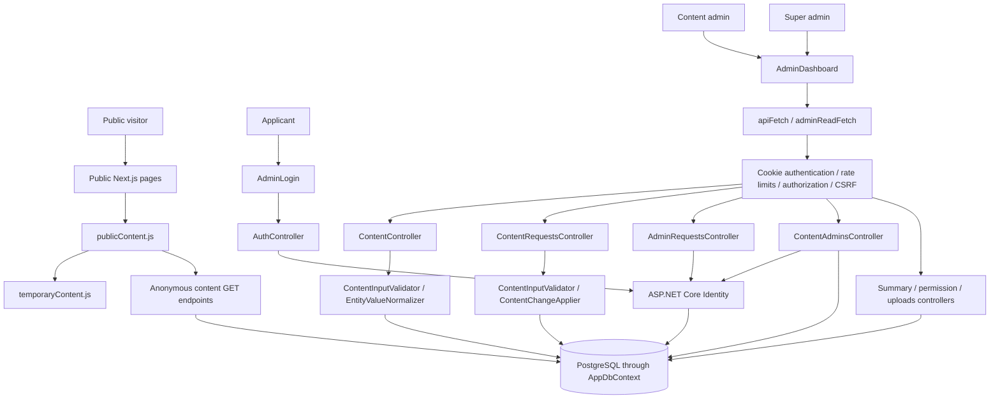
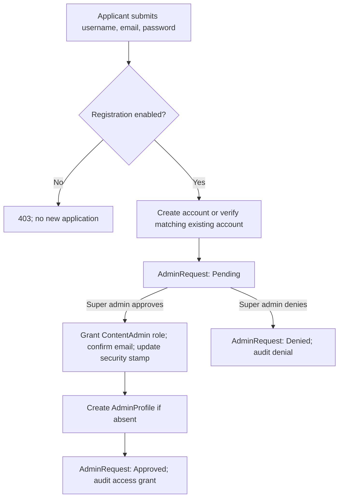
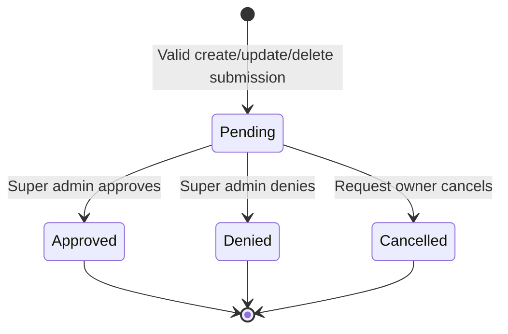
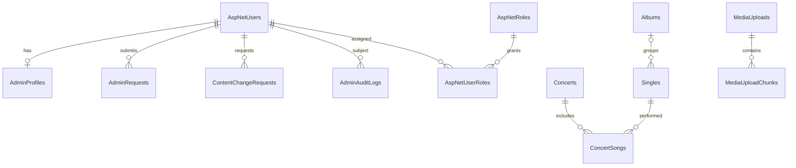

# Admin system schema

Code snapshot reviewed: 13 September 2026. This describes the current workspace, including the recent refresh, removal-approval, and optional timeline-description changes. It is a source-code analysis, not a live database inspection. The backend was not started for this review.

## 1. Architecture



The frontend is Next.js 15 / React 19. The API is ASP.NET Core, using Entity Framework Core and PostgreSQL. Authentication uses ASP.NET Core Identity cookies rather than a frontend-stored bearer token.

`app/admin/page.jsx` enables the admin page only when `ENABLE_LOCAL_ADMIN=true`. This controls frontend availability; API authorization is separately enforced on endpoints. Next.js produces static output. The repository's documented production deployment is a static site with temporary content, without the local API/database service.

The local configuration currently selects `NEXT_PUBLIC_CONTENT_SOURCE=temporary`, `NEXT_PUBLIC_LOCAL_ADMIN_OVERLAY=true`, and an API base of `http://localhost:5001`. Therefore public pages combine temporary rows with local API rows. Admin operations edit the database, not `temporaryContent.js`.

## 2. Roles and permission boundaries

| Capability | Visitor / applicant | Content admin | Super admin |
|---|---|---|---|
| Read published content | Yes | Yes | Yes |
| Submit signup request | Anonymous registration, when enabled | Already-admin accounts rejected | Already-admin accounts rejected |
| Log in | Valid confirmed account required | Yes | Yes |
| View admin content collections | No admin dashboard | Yes | Yes |
| Publish, edit, delete public records directly | No | No | Yes |
| Submit create/update/delete requests | No | Yes | API also allows this role; UI normally writes directly |
| Read own content-request history | Authenticated owner endpoint | Yes | Yes |
| Cancel a pending content request | Authenticated owner only | Own requests | Own requests only |
| Read all pending content requests | No | No | Yes |
| Approve or deny content changes | No | No | Yes |
| Approve or deny admin applications | No | No | Yes |
| List content admins and audit logs | No | No | Yes |
| Revoke content-admin access | No | No | Yes, with password confirmation |
| Enable/disable public admin applications | No | No | Yes |
| Upload image/video media | No | Yes | Yes |

Identity role membership and `AdminProfile.AdminKind` are separate records. For an administrator's session to remain valid, the matching profile must exist and be active. Setting a role name in browser storage never grants server access.

## 3. Authentication and session lifecycle

```mermaid
sequenceDiagram
    participant B as Browser
    participant A as API
    participant I as Identity / database
    B->>A: GET /api/auth/csrf
    A-->>B: CSRF cookie and request token
    B->>A: POST /api/auth/login + X-CSRF-TOKEN
    A->>I: Find email or username; verify password/account
    I-->>A: Sign-in result and roles
    A-->>B: Paralyze.Auth cookie + current user
    B->>A: GET /api/auth/me with cookie
    A->>I: Validate user, security stamp, active profile
    A-->>B: User ID, username, email, display name, roles
    B->>A: Protected reads / CSRF-protected writes
```

- `Paralyze.Auth` is HttpOnly, has an eight-hour authentication-ticket lifetime, and uses sliding expiration. Login requests a nonpersistent session cookie.
- `Paralyze.Csrf` is HttpOnly. The token returned by `/csrf` is sent in `X-CSRF-TOKEN` on unsafe controller methods, including login and registration.
- The frontend sends cookies with `credentials: include`. CORS permits credentials only for configured origins.
- Cookie validation checks the user exists, is enabled, has confirmed email, has a valid security stamp, and, for admin roles, has an active matching profile.
- Security-stamp validation is configured with a zero interval. Revocation can therefore take effect on the next authenticated request.
- The dashboard additionally calls `/api/auth/me` every ten seconds and on browser focus. This is a UI check, not the server's authorization boundary.
- Logout changes the security stamp and signs out. Changing the stamp invalidates other existing cookies for the same account as well.
- A confirmed content-admin revocation uses error code `content_admin_access_revoked`. The frontend distinguishes this from ordinary session expiry.
- Password hashing uses bcrypt with work factor 12. Existing Identity password hashes can be upgraded after successful verification. Minimum password length is 12; lockout is 15 minutes after five failed sign-ins.

## 4. Administrator application workflow



The browser signup path is `POST /api/auth/register-content-admin-request`. It checks `SiteSettings.CaRegistrationRequestsEnabled`. New applicants have an account but no admin role. Registration is not immediate administrative access.

For an existing account, username and email must refer to the same user; its password must match; it must not already have an admin role or pending application. Approval confirms email in code; this workflow does not implement a separate email-confirmation link.

There can be many applications per user over time, but a filtered unique database index allows only one Pending application per user. Approval uses a serializable transaction and a conditional Pending-to-Approved transition before applying role/profile changes.

`AdminRequestStatus` defines Cancelled, but `AdminRequestsController` exposes no cancellation endpoint. The implemented application transitions are Pending → Approved or Pending → Denied.

There is also an authenticated non-admin `POST /api/content-admin-requests` endpoint. Unlike the anonymous registration endpoint, it does not check the registration-permission setting. This distinction is part of the current code.

## 5. Content change workflow



Submitting a request records proposed work in `ContentChangeRequests`; it does not change the public content tables. Direct super-admin changes bypass this request table and write through `ContentController`.

| Action | Data stored at submission | Approval behavior |
|---|---|---|
| Create = 1 | Content type and JSON payload | Validate and insert a new entity; generated primary key replaces supplied key |
| Update = 2 | Target ID, target hash, JSON payload | Target must still exist and hash must match; validate replacement values and preserve primary key |
| Delete = 3 | Target ID and target hash; frontend sends `{}` payload | Delete current target regardless of hash changes; if already absent, approve successfully without another deletion |

New update/removal requests require an existing target at submission time. The already-absent behavior applies when reviewing an existing removal request later.

`TargetVersion` is a SHA-256 hash of serialized target content, not a numeric revision or database foreign key. It is checked only for Update approval. A missing/changed update target returns a conflict and the request remains Pending.

Only Pending requests can transition. Re-approving an Approved request returns a conflict even though approving two different removal requests for an already-removed target can both succeed. The latter is deliberate: both removal requests' desired result is satisfied.

Relational approval finalizes the status and applies content within a serializable transaction. Conditional updates and the concurrency-token Status field prevent stale approve/deny/cancel operations from overwriting a completed decision. Serialization failures, deadlocks, and EF concurrency exceptions become HTTP 409. Mutations are not automatically replayed.

## 6. Database relationships

Solid relationships below represent configured foreign keys. Target/reviewer identifiers discussed afterward are logical references instead.



### Identity and administrative tables

| Table | Key and principal fields | Relationships / constraints |
|---|---|---|
| AspNetUsers | String Id; UserName, Email, PasswordHash, SecurityStamp, EmailConfirmed, lockout fields; DisplayName?, CreatedAtUtc, IsDisabled | Extends IdentityUser; unique email required by Identity configuration |
| AspNetRoles | String Id, Name, NormalizedName | Role definitions including SuperAdmin and ContentAdmin |
| AspNetUserRoles | UserId + RoleId | Identity join table; user-to-role membership |
| AdminProfiles | GUID Id; UserId; AdminCode; AdminKind; IsActive; ApprovedAtUtc; ApprovedByUserId?; DisabledAtUtc?; DisabledByUserId? | Unique UserId and AdminCode; one profile per user; UserId FK cascades on user deletion |
| AdminRequests | GUID Id; RequestCode; UserId; Status; Message?; RequestedAtUtc; ReviewedBySuperAdminId?; ReviewedAtUtc?; ReviewNote? | Unique RequestCode; one Pending request per user; UserId FK cascades |
| ContentChangeRequests | GUID Id; ChangeCode; RequestedByUserId; ContentType; TargetEntityId?; TargetVersion?; Action; Status; PayloadJson; Message?; RequestedAtUtc; ReviewedBySuperAdminId?; ReviewedAtUtc?; ReviewNote? | Unique ChangeCode; indexes by type/status and requester/status; requester FK cascades |
| AdminAuditLogs | GUID Id; AdminUserId; PerformedByUserId?; Action; EntityType?; EntityId?; DetailsJson?; CreatedAtUtc | AdminUserId FK to subject user; cascades on deletion; index by user/time |
| SiteSettings | String Key, BooleanValue | Key is primary key; registration permission and initial-bootstrap marker |

`AdminKind`: ContentAdmin = 1, SuperAdmin = 2. Both request-status enums use Pending = 1, Approved = 2, Denied = 3, Cancelled = 4.

Request codes are display identifiers. The actual generator uses prefixes `AREQ`, `CHG`, and `CADM` plus a random GUID-derived suffix. Some model comments show sequential examples, but the current generator is not sequential.

`ContentType + TargetEntityId` selects one of seven content tables in application code. There is no polymorphic foreign key. Deleting a content row therefore does not automatically delete pending requests about it.

`ReviewedBySuperAdminId`, `ApprovedByUserId`, `DisabledByUserId`, `PerformedByUserId`, and audit `EntityType + EntityId` are stored identifiers without corresponding configured relationships in `AppDbContext`.

### Content tables

| API content type | Table / primary key | Principal fields | Required input |
|---|---|---|---|
| concerts | Concerts / ConcertId: int | Date, Location, Time?, NumberOfSongs | Date, Location; nonnegative song count |
| albums | Albums / AlbumId: int | Title, ReleaseDate?, PhotoUrl?, TrackListJson?, NumberOfSongs | Title; nonnegative song count |
| singles | Singles / SongId: int | SongName, ReleaseDate?, Description?, PhotoUrl?, AvailableOnYoutube?, AvailableOnSpotify?, AlbumId? | SongName; supplied AlbumId must exist |
| news | News / NewsId: int | Title, Content, PublicationDate, Author | All four |
| timeline | TimeLines / Id: int | Date, Event, Description, Location | Date and Event; Description and Location optional |
| members | Members / Id: int | Name, Instrument, PhotoUrl? | Name, Instrument |
| gallery | Gallery / Id: int | Title, Description, ImageUrl? | Title |

Timeline Description is optional input but remains a NOT NULL string column: missing/null input is normalized to an empty string. Database `.IsRequired()` here prevents SQL NULL, not an empty description. The public timeline hides blank descriptions and locations.

Deleting an album sets linked Singles.AlbumId to NULL; it does not delete the singles. `ConcertSongs` has composite primary key `(ConcertId, SongId)` and cascades when either referenced concert or single is deleted. It is a supporting relationship, not one of the seven admin sections. Album `TrackListJson` is separate from the normalized Singles relationship.

### Media tables and upload behavior

| Table | Fields / constraints |
|---|---|
| MediaUploads | GUID Id; FileName; ContentType; Kind; Length; Data; CreatedAtUtc |
| MediaUploadChunks | GUID Id; MediaUploadId FK; Sequence; Data; unique `(MediaUploadId, Sequence)`; cascade with upload |

Images up to 25 MiB are checked for extension, declared MIME type, and file signature, then returned as a base64 data URL. The eventual content payload stores that URL; image upload itself does not create a MediaUploads row.

Videos up to 100 MiB are validated and stored as MediaUploads metadata plus 512 KiB chunks. The returned URL is `/api/uploads/videos/{id}`. Retrieval is anonymous and supports video delivery; uploading and approving publication are separate actions. There is no configured content-row-to-media foreign key, uploader-user field, or upload-delete endpoint in this controller.

## 7. Dashboard layout and data flow

```text
/admin
├── Sign in / Content Admin Signup
└── Authenticated dashboard
    ├── Current user, role, sign out
    ├── Totals: Public rows / Pending review / Active content admins (SA)
    ├── CA registration permission switch (SA)
    ├── Content sidebar: Concerts, Albums, Singles, News, Timeline, Members, Gallery
    ├── Selected collection editor and public-record list
    ├── Pending approval queue (SA) or own request history (CA)
    ├── Content-admin signup requests (SA)
    ├── Content-admin management and password-confirmed removal (SA)
    └── Audit history (SA)
```

`AdminDashboard.jsx` owns session, selected collection, records, drafts, editing state, summary, requests, admin profiles, audit selection, pagination, errors/notices, loading state, and a mutation lock.

Startup restores a validated section key from per-tab sessionStorage, verifies `/api/auth/me`, then loads collections, summary, and role-specific lists. localStorage stores only a role hint used for expiry messaging. Unsaved form drafts are React state and do not survive a full page refresh.

Direct super-admin create/update/delete reloads the affected collection and summary: two data reads instead of the full twelve. Deletion also removes the successfully deleted row from local state immediately. Full startup and request/admin review actions still use the broader dashboard refresh. Content-admin create/update submissions skip public-collection reloading, but other request actions retain the broader refresh path.

Summary values are retained while refreshing. A failed refresh marks them stale with an explicit message. An initial failed load has no previous values to display and may show Unavailable.

| Counter | Actual calculation |
|---|---|
| Public rows | Sum of rows in Albums, Singles, Concerts, News, TimeLines, Members, Gallery |
| Pending review, super admin | All Pending ContentChangeRequests |
| Pending review, content admin | Only that user's Pending ContentChangeRequests |
| Active content admins | ContentAdmin profiles with IsActive=true and user IsDisabled=false; returned only for super admin |

Public rows excludes temporary content, media, join rows, and requests. Pending review excludes admin signup requests. Active content admins is a profile/user-state count, not an online-user count or a direct role-membership count.

Each admin read attempt normally receives a fresh 20-second timeout. GET/HEAD can retry HTTP 429/503 up to three times after the initial attempt. Retry-After is honored; fallback waits are 30 seconds for 429 and exponential seconds for 503. Startup session verification explicitly disables retries. Startup dashboard retries update the loading message. POST/PUT/DELETE are not automatically retried; CSRF and upload fetches are separate from the read helper.

Content browsing uses ascending immutable-ID cursors in admin. Public API browsing supports page pagination and date/name sorting. Pending queues use `(RequestedAtUtc, Id)` ascending cursors; own history uses descending cursors. Audit uses `(CreatedAtUtc, Id)` descending cursors. Most pages are capped at 50; audit can return up to 100.

## 8. API map

Paths are relative to the API base. SA = SuperAdmin, CA = ContentAdmin. All unsafe controller methods also require antiforgery validation.

| Method and path | Access | Purpose |
|---|---|---|
| GET /api/auth/csrf | Anonymous | Acquire CSRF token/cookie |
| POST /api/auth/login | Anonymous | Sign in by username/email |
| POST /api/auth/register-content-admin-request | Anonymous, registration setting checked | Register/apply |
| GET /api/auth/me | Authenticated | Current user and roles |
| POST /api/auth/logout | Authenticated | Revoke stamp and sign out |
| GET /api/content/{type} | Anonymous | Published records |
| POST /api/content/{type} | SA | Direct publish |
| PUT /api/content/{type}/{id} | SA | Direct update |
| DELETE /api/content/{type}/{id} | SA | Direct delete |
| POST /api/content-requests | SA or CA | Submit change |
| GET /api/content-requests/mine | Authenticated, owner-filtered | Own history |
| GET /api/content-requests/pending | SA | Pending queue |
| GET /api/content-requests/{id} | SA | Request detail |
| POST /api/content-requests/{id}/approve | SA | Apply and approve |
| POST /api/content-requests/{id}/deny | SA | Deny |
| POST /api/content-requests/{id}/cancel | Authenticated owner | Cancel own pending request |
| POST /api/content-admin-requests | Authenticated non-admin | Additional application route |
| GET /api/content-admin-requests/pending | SA | Signup queue |
| GET /api/content-admin-requests/{id} | SA | Signup detail |
| POST /api/content-admin-requests/{id}/approve | SA | Grant access |
| POST /api/content-admin-requests/{id}/deny | SA | Deny application |
| GET /api/content-admins | SA | Admin list |
| GET /api/content-admins/{userId} | SA | Admin detail |
| DELETE /api/content-admins/{userId} | SA + password | Revoke content-admin access |
| GET /api/content-admins/audit | SA | All audit records |
| GET /api/content-admins/{userId}/audit | SA | User's audit records |
| GET /api/admin-dashboard/summary | SA or CA | Role-scoped counters |
| GET /api/ca-requests-permission | SA | Registration setting |
| PUT /api/ca-requests-permission | SA | Change registration setting |
| POST /api/uploads/images | SA or CA | Validate image and return data URL |
| POST /api/uploads/videos | SA or CA | Store video and return media URL |
| GET /api/uploads/videos/{id} | Anonymous | Read video |

## 9. Revocation and audit

Revocation verifies the reviewing super admin's password, refuses to remove a super admin through this endpoint, removes the ContentAdmin role, updates the security stamp when that role is removed, deletes the ContentAdmin profile, and writes `content_admin_access_revoked`.

The user account, published content, and historical requests remain. Removing an admin profile is different from deleting an Identity user: deleting the user would cascade to its profile, applications, content-change requests, and subject audit logs under the configured relationships.

Audit actions include `content_created`, `content_updated`, `content_deleted`, `content_change_requested`, `content_change_approved`, `content_change_denied`, `content_change_cancelled`, `content_admin_access_granted`, `content_admin_request_denied`, and `content_admin_access_revoked`.

`AdminUserId` is the audit subject; `PerformedByUserId` is the actor. For example, approval records the requester as subject and super admin as actor. Audit rows do not necessarily contain a full before/after content snapshot.

Audit transaction placement differs: content-request create/approve/deny commit their main transaction before writing the audit log; admin access grant/denial/revocation write audit within their transaction. Consequently, an audit-write failure can report an error after a content operation already committed. This is an implementation distinction, not a guarantee of complete atomic audit coverage.

## 10. Rate limits and startup

Limits partition authenticated calls by username and anonymous calls by client IP.

| Policy | Capacity | Refill | Applied to |
|---|---:|---|---|
| Global concurrency | 12 simultaneous calls | Released when completed | API requests passing rate-limit middleware |
| Admin read token bucket | 130 | 1 token / second | Authenticated SuperAdmin/ContentAdmin GET requests |
| Ordinary token bucket | 60 | 30 tokens / 30 seconds | All other requests passing rate-limit middleware |
| AuthSensitive | 5 | 2 / minute | Login, anonymous admin registration |
| AdminMutation | 20 | 10 / minute | Content-request submission, registration-setting change |
| ReauthSensitive | 5 | 1 / 5 minutes | Content-admin removal |
| UploadSensitive | 5 | 2 / minute | Image/video upload |

Queues are disabled. Rejected requests return 429. Named limits supplement the global limits; the name AdminMutation does not mean every write has that named policy. Direct content writes and approval/denial endpoints currently rely on the global limiter.

Admin reads and ordinary requests use separate token buckets, but share the same 12 concurrent slots per client. Refreshes therefore cannot consume the ordinary write allowance. The separate buckets allow up to two requests per second combined for an admin doing both reads and writes; admin reads alone retain the previous sustained average of one request per second. Login, upload, and other named policies are unchanged.

A super-admin startup makes 13 API requests (session, seven content collections, summary, and four administration reads); a content-admin startup makes 10. A full admin-read bucket accommodates ten complete super-admin reloads without token-limit waiting, excluding other tabs, focus checks, the 10-second session poll, and overlapping requests. This is a bounded burst allowance, not unlimited refresh or a latency guarantee. After exhaustion the server still returns 429 and the frontend honors Retry-After. Sequential one-second replenishment avoids the previous 30-second refill boundary for admin reads.

Load assessment: the seven collection reads each return at most 50 rows. Summary executes nine database counts for a super-admin and eight for a content-admin, so ten super-admin reloads execute 90 count queries plus list and authentication queries. Counts may become expensive as tables grow. Cookie validation queries users, roles, and active profiles on every authenticated request and runs BEFORE the rate limiter; the limiter does not protect that authentication work. Limits are per client and per API process, not a shared server/database capacity limit. Multiple admins, multiple API instances, and repeated abandoned browser loads can still overload a small database. No production capacity claim follows from limiter tests; validating that requires representative database sizes and concurrent-user load measurements (latency, database CPU, connections, and 429 rate). No sensitive data is cached and authorization freshness is preserved by this change.

Database migrations run at API startup. Bootstrap uses `InitialAdminBootstrapCompleted` to avoid recreating administrator accounts on every restart. Initial administrators are created only for an empty, not-yet-bootstrapped user database. Existing users are not silently promoted or repaired by the seeder.

## 11. Current boundaries worth keeping visible

1. Database publication and static deployment are different. Current local overlay can show both data sources. Removing a database row cannot remove a hardcoded temporary row.
2. Overlay loading calls the API once without traversing later pages; backend-only loading walks pages. Overlay therefore does not necessarily include all database rows beyond the first API page.
3. Super-admin direct changes bypass approval and target-hash checking. Content-admin updates require approval and hash matching.
4. Multiple removal requests can refer to the same row; there is no unique pending-request constraint per content target.
5. Removing a content admin does not automatically cancel that user's pending content requests. Approval does not re-check the original requester's current role.
6. Video retrieval is anonymous immediately after upload; content approval controls linking/publication, not private access to the video URL.
7. No endpoint here edits or reopens a submitted request. The normal replacement path is cancellation/denial plus a new submission.
8. No browser database connection exists. Browser storage is convenience state; API/database checks control access.

## 12. Source map

- Frontend entry: [app/admin/page.jsx](../app/admin/page.jsx).
- Dashboard, role views, refreshes and mutations: [AdminDashboard.jsx](../components/AdminDashboard.jsx).
- Sign-in/signup UI: [AdminLogin.jsx](../components/AdminLogin.jsx).
- Read deadlines/retries: [adminReadFetch.js](../components/adminReadFetch.js).
- Draft normalization: [adminDraft.js](../components/adminDraft.js).
- Public sources: [publicContent.js](../components/publicContent.js), [publicContentMerge.js](../components/publicContentMerge.js).
- Authentication, cookies, middleware, limits: [Program.cs](<../Back End/MyApi/Program.cs>), [AuthController.cs](<../Back End/MyApi/Controllers/AuthController.cs>).
- Foreign keys and indexes: [AppDbContexts.cs](<../Back End/DB/MyLibrary/AppDbContexts.cs>).
- Signup approval: [AdminRequestsController.cs](<../Back End/MyApi/Controllers/AdminRequestsController.cs>).
- Content approval: [ContentRequestsController.cs](<../Back End/MyApi/Controllers/ContentRequestsController.cs>).
- Direct content operations: [ContentController.cs](<../Back End/MyApi/Controllers/ContentController.cs>).
- Applying changes: [ContentChangeApplier.cs](<../Back End/MyApi/Services/ContentChangeApplier.cs>), [ContentInputValidator.cs](<../Back End/MyApi/Services/ContentInputValidator.cs>).
- Revocation/audit listing: [ContentAdminsController.cs](<../Back End/MyApi/Controllers/ContentAdminsController.cs>).
- Counters: [AdminDashboardController.cs](<../Back End/MyApi/Controllers/AdminDashboardController.cs>).
- Uploads: [UploadsController.cs](<../Back End/MyApi/Controllers/UploadsController.cs>).
- Concurrency: [RequestConcurrencyGuard.cs](<../Back End/MyApi/Services/RequestConcurrencyGuard.cs>).
- Bootstrap: [DatabaseSeeder.cs](<../Back End/DB/MyLibrary/DatabaseSeeder.cs>).

This review created documentation only and did not change application behavior.
